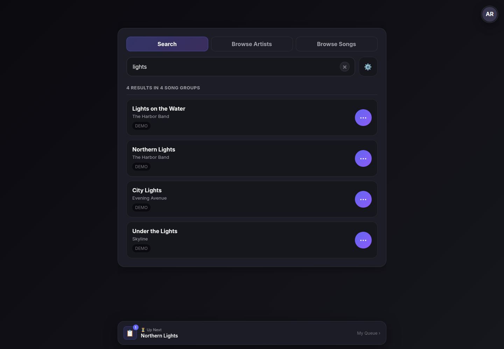
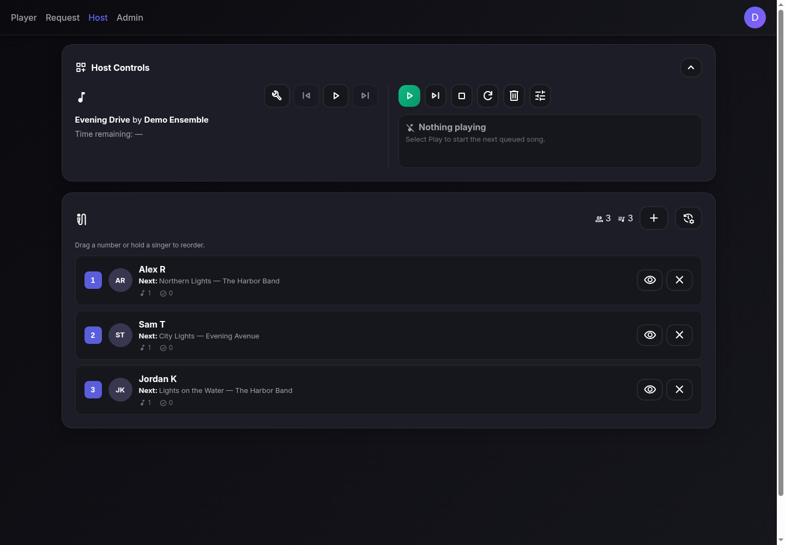
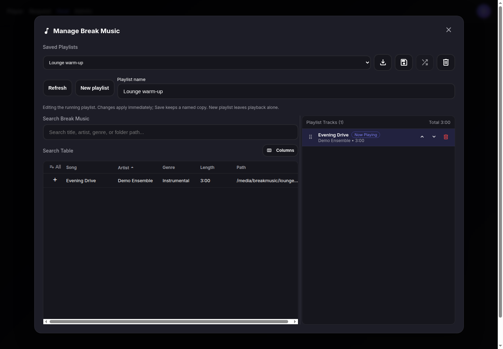
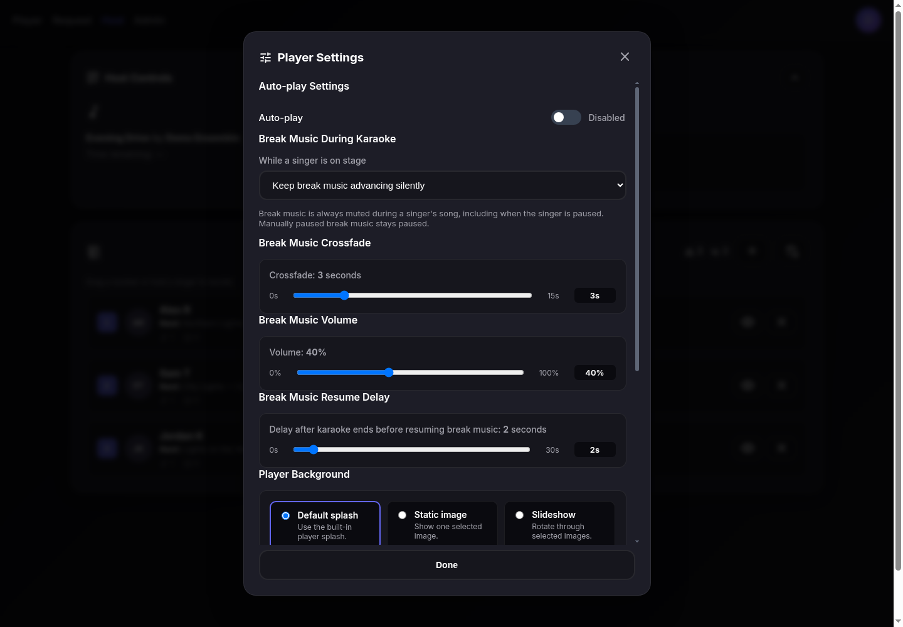
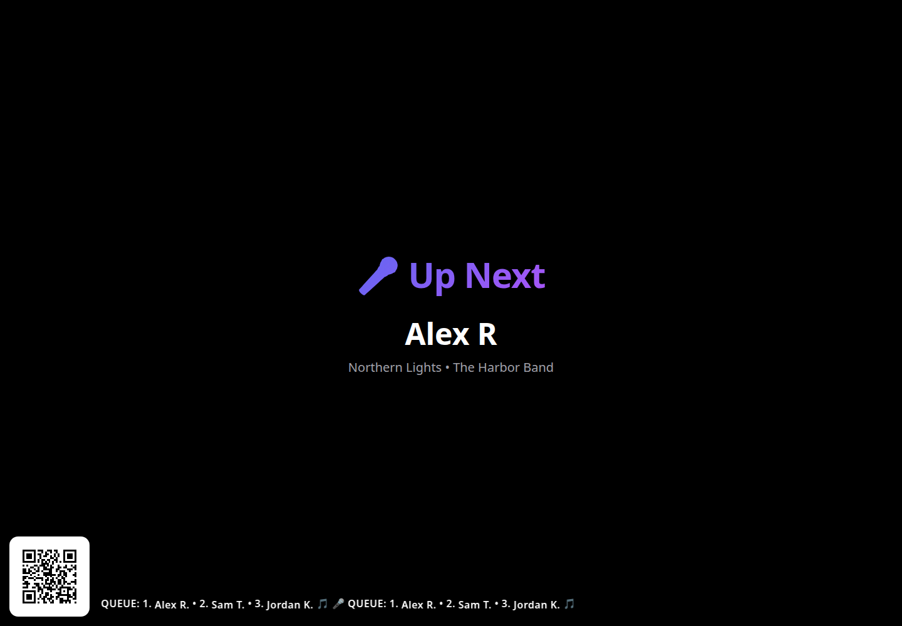
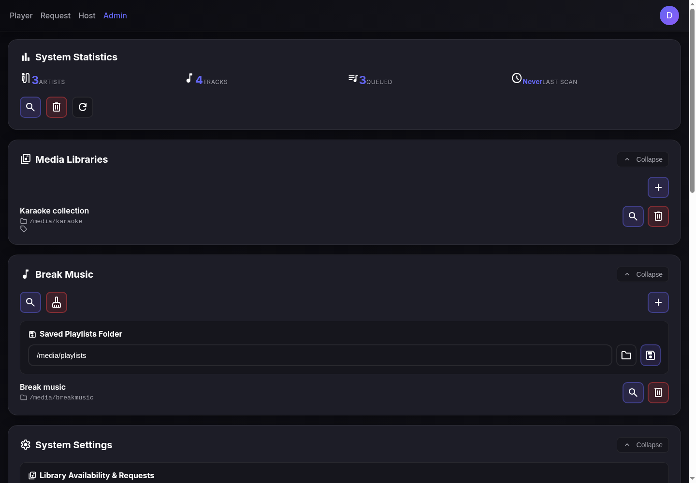

# KaraokeDock

Self-hosted karaoke with local media, online song search, singer profiles,
rotation management, and a separate TV/projector Player.

KaraokeDock brings local libraries and external karaoke sources together so hosts
can manage the show from one screen while guests request songs from their phones.

## Contents

- [Changelog and upgrade notes](../CHANGELOG.md)
- [Features](#features)
- [Web pages overview](#web-pages-overview)
- [Quick start with Docker](#quick-start-with-docker)
- [First-time setup](#first-time-setup)
- [Authentication and roles](#authentication-and-roles)
- [Install Host and Player apps](#install-host-and-player-apps)
- [Configuration](#configuration)
- [Managing the application](#managing-the-application)
- [Troubleshooting and login recovery](#troubleshooting)
- [Architecture](#architecture)
- [Development](#development)

## Features

- Local MP4, CDG+MP3, and ZIP karaoke libraries, with FFmpeg transcoding and
  pitch adjustment.
- Combined local and Karaoke Nerds search, relevance-ranked results, and
  artist/song browsing.
- Live singer queues, drag-and-drop ordering, multiple rotation policies,
  autoplay, singer recall, and history import/export.
- Break music playlists, crossfades, and a choice to pause or silently advance
  break music during a performance.
- Singer profiles, pictures and crops, optional Google/Facebook login, and
  administrator-managed account linking.
- Local password login and OIDC group-based roles.
- Fullscreen Player with QR code, scrolling queue, custom backgrounds, and
  separate Host/Player PWA installation.
- Signed sideload APKs for Android TV/NVIDIA Shield and Android 13 iKarao devices.

See [features and capabilities](features-and-capabilities.md) for the detailed
reference.

## Web pages overview

Replace `your-server:5173` with your server address or public HTTPS hostname.

| Page | Path | Purpose |
| --- | --- | --- |
| Request | `/request` or `/` | Search, request songs, and manage your singer profile/history |
| Host | `/host` | Run the show, manage singers, playback, rotation, and break music |
| Player | `/player` | Display karaoke on a TV or projector |
| Admin | `/admin` | Configure libraries, users, authentication, and system settings |

Old `/requests` links redirect to `/request`. Unknown page paths return 404.
Public legal pages are available at `/privacy` and `/terms`.

The screenshots below were captured from the current UI on **2026-10-23** with
fictional singers and sample catalog data, not a live venue or production account.

### Request

Search local and enabled online sources from the same page. Browse Artists and
Browse Songs reuse the main query and restrict it to the selected field. Open
the cog for search options; use the profile menu for name, picture, history,
logout, and application version.



### Host

Managed Users and Admins can add singers, reorder or clear queues, recall
singers, manage history, and control playback. Drag a queue number or hold a
singer card to reorder on supported touch devices.



#### Manage break music

The manager opens the running playlist; edits apply immediately. **New playlist**
starts an independent draft without interrupting playback. Name and **Save** it,
then select a saved playlist and **Load** when ready to switch.

The current song stays at the top of the running playlist and rotates to the
bottom when finished or skipped. Saved playlists and independent drafts are
unchanged. Save drafts before reloading the Host page.

Search matches title, artist, genre, and indexed file path. Enable the **Path**
column to inspect folder matches; **Add All** adds the filtered results. Playlists
are stored in the database. If optional M3U export fails, the manager reports a
warning without discarding the saved playlist.



#### Configure playback settings

Use Host's settings control for autoplay, rotation, break music behavior,
backgrounds, and QR/scroller options.



### Player

Open Player on the show display and control it from Host on another device.
The QR code and scroller remain separate from video playback. Local video uses
cover sizing, which can crop edges when aspect ratios differ.



### Admin

Admins manage media libraries and scans, break music folders, accounts,
authentication, library availability, and public legal information. Linking
social logins to a managed account is an explicit Admin action; matching names
does not automatically grant access.



## Quick start with Docker

You need Docker Engine with the Compose plugin, storage for PostgreSQL, and
optional karaoke/break music files. See the official
[Docker installation](https://docs.docker.com/engine/install/) instructions.

1. Create a deployment directory and download the configuration:

   ```bash
   mkdir -p ~/karaokedock
   cd ~/karaokedock
   curl -fLO https://raw.githubusercontent.com/haggardj2/KaraokeDock/refs/heads/main/docker-compose.yml
   curl -fLo .env.example https://raw.githubusercontent.com/haggardj2/KaraokeDock/refs/heads/main/.env.example
   cp .env.example .env
   ```

2. Edit `.env`. Set a strong `POSTGRES_PASSWORD`, existing host media paths, and
   writable `DB_PATH`, `DOWNLOADS_PATH`, `IMAGES_PATH`, and `SNAPSHOTS_PATH` directories. Use an
   address guests can reach for `WEB_APP_URL` and `ORIGIN`, not `localhost`:

   ```env
   WEB_APP_URL=http://192.168.1.20:5173
   ORIGIN=http://192.168.1.20:5173
   APP_PORT=5173
   ```

3. Start the stack and inspect its status:

   ```bash
   docker compose up -d
   docker compose ps
   docker compose logs -f app
   ```

The Compose services are **`app`** and **`db`**; their container names are
`karaokedock` and `karaokedock-db`. The combined web/API app uses port 5173.
The database is PostgreSQL 18. Startup runs database migrations automatically.

**Runtime security:** Main app, web, and Gateway container builds pin Node.js
26.12.1 to address CVE-2026-111497. Existing deployments must use rebuilt images;
source changes do not patch running containers. Station desktop builds remain
blocked until a patched Electron runtime is available. See the
[security upgrade notes](../CHANGELOG.md#brotli-runtime-security-cve-2026-111497).

For Unraid, see the [Unraid setup guide](unraid_readme.md).

## First-time setup

1. Open `http://your-server:5173/admin`. On a fresh installation with no
   configured administrator password, retrieve the generated bootstrap
   credentials from `docker compose logs app`.
2. Sign in and change the bootstrap password immediately.
3. Add a karaoke library using its **container path**, normally `/media/karaoke`,
   and scan it. Add `/media/breakmusic` as a break music folder if needed.
4. Open `/host`, sign in, and configure rotation/playback.
5. Open `/player` on the show display or install a [signed APK](#android-signed-apk-downloads).
6. Direct singers to `/request` or the Player's QR code.

## Authentication and roles

**Upgrading an existing OIDC installation? Read the
[breaking-change and recovery notes](../CHANGELOG.md#oidc-sign-in-now-requires-group-membership)
before updating.**

| Account | Access |
| --- | --- |
| Managed User | All Host functions; no Admin page |
| Admin | Host and Admin |
| Standalone social singer | Request/profile functions, not Host administration |

OIDC requires exact, case-sensitive `groups` membership:
`karaokedock_admin` maps to Admin; `karaokedock_user` maps to User. Admin wins
when both are present. Roles synchronize on each OIDC login; the old default
role setting no longer grants access.

The provider must include the claim in its ID token or subject-validated
UserInfo response. KaraokeDock requests the `groups` scope when discovery
advertises it. Missing membership rejects login, revokes existing sessions,
and removes Admin status without disabling the account. Previously disabled
accounts still need administrator reactivation.

Configure OIDC credentials through Admin; they remain in database settings and
the secret is masked in responses. Rotate any previously exposed secret at the
provider and save the replacement in Admin.

See [OIDC and Google/Facebook configuration](SOCIAL_LOGIN.md). If locked out, use
[Reenable Password Login](#reenable-password-login) and [Forgot Login](#forgot-login).


## PWA Browser installation

Open `/host` or `/player` using trusted **HTTPS**, then select **Install Host app**
or **Install Player app**. Chrome/Edge support installation where available;
on iPhone/iPad use Safari's **Share > Add to Home Screen**, enabling **Open as Web
App** if offered.

Host and Player install separately and launch directly into their respective
pages. **Dismiss** hides that app's prompt for the browser; browser-menu
installation remains available. Production builds support installation; plain
HTTP LAN addresses and the Vite development server do not, except localhost
where the browser permits it.

Both require a live server and do not cache songs, credentials, queue state, or
offline actions. Offline launches show a reconnect page. Browser audio/autoplay
restrictions still apply.

Player fits the visible mobile viewport and supports portrait/landscape. Tap
to reveal fullscreen controls where supported. It requests a screen wake lock
while visible and reacquires it on return; browser/OS restrictions may deny or
release it, with a visible retry option. It cannot override the power button or
keep a hidden app awake.

### Android signed APK downloads

| Device | Signed sideload APK |
| --- | --- |
| NVIDIA Shield / Android TV (Android 7.0+) | [Universal Android TV APK](../PlayerTV/release/KaraokeDock-Player-1.1.3-v7-AndroidTV-universal-signed.apk) |
| iKarao S1 and other Android 13 iKarao devices | [Android 13 tablet APK](../PlayerTV/release/KaraokeDock-Player-1.1.3-v7-Android13-tablet-signed.apk) |

Download the appropriate APK, transfer it to the device, permit installation
from your file manager, and install. Open **KaraokeDock Player**, enter the server
address, and select **Save and open Player**. Use Back/Menu for TV settings.

Both packages support 32-bit and 64-bit devices and do not include Google Play's
installer protection. The TV package requires Leanback; the tablet package does
not. Keep Android System WebView updated. A live server is required; the wrapper
uses Android's native keep-screen-on behavior.

If an existing Play-installed or debug-signed copy has a different signing key,
uninstall it first; this clears its saved server address. Only these two signed
APKs are published under `PlayerTV/`, not source, build tools, or signing material.

Authorized Google Play testers can use the
[testing app link](https://play.google.com/apps/test/com.karaokedock.player/7).
Play-protected packages may redirect to the store if sideloaded; use the signed
downloads above for sideloading.

## Configuration

Deployment settings come from `.env`/container environment variables. Libraries,
users, OIDC/social credentials, and show settings are managed through the app and
stored in PostgreSQL; they are not all configured through `.env`.

| Variable | Purpose |
| --- | --- |
| `APP_PORT` | Published app port; default 5173 |
| `POSTGRES_DB`, `POSTGRES_USER`, `POSTGRES_PASSWORD` | Bundled database credentials |
| `DB_PATH` | Persistent host PostgreSQL storage |
| `DB_PORT` | Published database port; default 5432 |
| `KARAOKE_PATH` | Host library mounted read-only at `/media/karaoke` |
| `DOWNLOADS_PATH` | Writable downloads mounted at `/media/downloads` |
| `BREAKMUSIC_PATH` | Host music mounted read-only at `/media/breakmusic` |
| `IMAGES_PATH` | Writable profile/background images mounted at `/media/images` |
| `SNAPSHOTS_PATH` | Writable automatic database snapshots and their key, mounted at `/app/snapshots` (defaults to `./snapshots` beside the compose file) |
| `MEDIA_ROOT` | Container media root, normally `/media` |
| `WEB_APP_URL` | Reachable web origin used for default request/QR URLs |
| `ORIGIN` | Comma-separated allowed browser origins |
| `TRUST_PROXY` | Proxy trust configuration; match your actual proxy topology |

The Compose file builds `DATABASE_URL` from the database credentials. Other
deployments can provide `DATABASE_URL` directly, or use `DB_HOST`, `DB_PORT`,
`DB_NAME`, `DB_USER`, and `DB_PASSWORD`. In the latter case, `DB_PORT` is the
database connection port, not the Compose host-port mapping.

For a reverse proxy, forward HTTP and WebSocket traffic to app port 5173, set
`WEB_APP_URL`/`ORIGIN` to the public HTTPS origin, and configure proxy trust for
the real number of trusted hops. Do not expose PostgreSQL to untrusted networks.
For Unraid external databases, attach the app to a network where the database
hostname resolves.

## Managing the application

Run these commands from the directory containing your Compose file and `.env`:

```bash
docker compose ps               # Status
docker compose logs -f app       # App logs
docker compose logs -f db        # Database logs
docker compose restart app      # Restart the app
docker compose down             # Stop the stack
```

Before upgrading, back up PostgreSQL and persistent media/images, and read the
[changelog](../CHANGELOG.md). Then:

```bash
docker compose pull
docker compose up -d
docker compose logs -f app
```

### Application versions

The profile menus on Host, Admin, and Request show `KaraokeDock vX.Y.Z`.
Player has no visible version label. Browser load and server startup logs also
report the version.


## Troubleshooting

| Symptom | Check |
| --- | --- |
| QR points to localhost | Set a reachable `WEB_APP_URL`; check the request URL in Admin |
| Another device cannot connect | Published app port, firewall, server address, and reverse proxy |
| CORS/WebSocket origin errors | Include the exact browser origin in `ORIGIN` |
| No songs after scanning | Host mounts, supported formats, container library path, and `docker compose logs app` |
| Database startup failure | `docker compose ps` and `docker compose logs db`; credentials and writable storage |
| File permission errors | Container read/write access; use appropriate SELinux labels where required |
| OIDC membership error | Exact groups, provider claim configuration, fresh SSO login, and updated server |
| APK opens Play Store | Use the signed sideload APK, not a sideloaded Play-protected package |

### Forgot Login

From the deployment directory, reset administrator access:

```bash
docker compose exec app npm run reset-credentials
# Or target your existing administrator username:
docker compose exec app npm run reset-credentials -- --username YOUR_ADMIN_USERNAME
```

Without `--password`, the helper generates and prints a secure password.
It defaults to username `admin`, activates the account, restores Admin access,
and signs out all sessions. If the requested username does not exist, it can
rename an existing administrator; specify your existing username to avoid that.
Store the password privately and change it after signing in.

For non-Compose containers, use
`docker exec -it YOUR_CONTAINER_NAME npm run reset-credentials`.
If the password form is disabled, also follow the next section.

### Reenable Password Login

```bash
docker compose exec app npm run re-enable_login
```

Without Compose, use
`docker exec -it YOUR_CONTAINER_NAME npm run re-enable_login`.

This enables the password form without resetting credentials or activating
disabled accounts. [Forgot Login](#forgot-login) restores administrator access;
both steps may be needed. Reload `/admin`, sign in locally, correct OIDC groups,
and re-enable affected accounts in **User Manager** before retrying SSO.

## Architecture

The standard deployment uses two containers:

```text
Browser / Android Player
          |
          v
app: React web + Express API + WebSocket + FFmpeg (5173)
          |
          v
db: PostgreSQL 18 (5432)
```

Media is indexed in PostgreSQL. Request and Host actions update the queue, which
is broadcast to connected clients. Player streams local video, transcoded CDG,
or supported external content. Library mounts are read-only; downloads and image
uploads use separate writable mounts.

The web app uses React 19, TypeScript 7, and Vite. The server uses Node.js,
Express, PostgreSQL, and FFmpeg with Rubber Band pitch shifting.

## Development

Use Node.js 26.12.1 or newer in the 26.x line for parity with the container images.
The supported alternatives are 22.23.4+ in 22.x and 24.22.1+ in 24.x.
The API and Gateway refuse runtimes without a recognized Brotli fix for
CVE-2026-111497. Official Node.js backports are accepted even though their
Brotli version strings remain unchanged. See the [upgrade notes](../CHANGELOG.md#brotli-runtime-security-cve-2026-111497),
including the current Station/Electron restriction.

The Gateway compiles its native SQLite dependency for Node.js 26 in its Docker
build stage, keeping compiler tools and development dependencies out of the
runtime image. For local upgrades between Node.js major versions, run `npm ci`
in `Gateway` to rebuild native dependencies; see the
[Gateway setup instructions](../Gateway/README.md#run-locally).

Install dependencies with
`npm ci` in each package you work on: `src/server`, `src/web`, `Gateway`, or
`Station`. See [running without Docker](../dev/build-without-docker.md) for host
dependencies, database configuration, and FFmpeg requirements.

For separate development processes, supply database/media environment variables
to the server before running migrations and starting it:

```bash
cd src/server
npm ci
npm run migrate
npm run dev
```

In another terminal:

```bash
cd src/web
npm ci
VITE_API_BASE=http://localhost:5174 npm run dev
```

The API defaults to 5174 and Vite to 5173 in this setup. Configure server
`ORIGIN` accordingly. Copying `.env.example` alone does not export variables
into these processes.

To build the combined image from the repository root:

```bash
docker build -f dev/Dockerfile -t haggardj2/karaokedock:latest .
```

### Checks

```bash
cd src/server
npx tsc --noEmit
npm test
```

```bash
cd src/web
npm run build
node --experimental-strip-types --test tests/*.test.mjs
```

Database-backed integration tests require their configured PostgreSQL test
environment. Frontend test helpers use esbuild and Oxc rather than TypeScript's
removed JavaScript compiler API.

## Security and support

Use trusted HTTPS, protect local configuration and database backups, change
bootstrap credentials, and keep images/WebView updated. Public frontend assets
are expected; authorization is enforced at protected API endpoints.

Report issues in [GitHub Issues](https://github.com/haggardj2/KaraokeDock/issues).
Include the app version and relevant logs, with passwords, tokens, and personal
information removed. Contributions are welcome.

See [LICENSE](../LICENSE).
